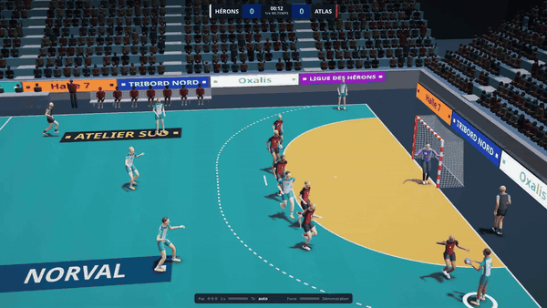
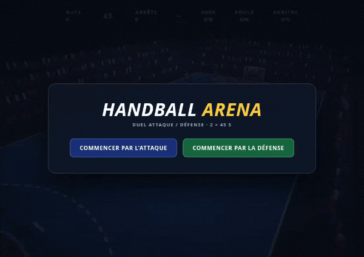
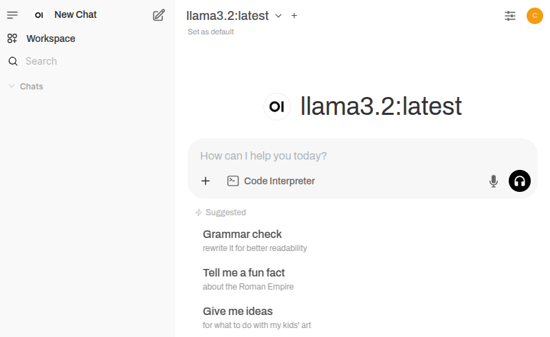
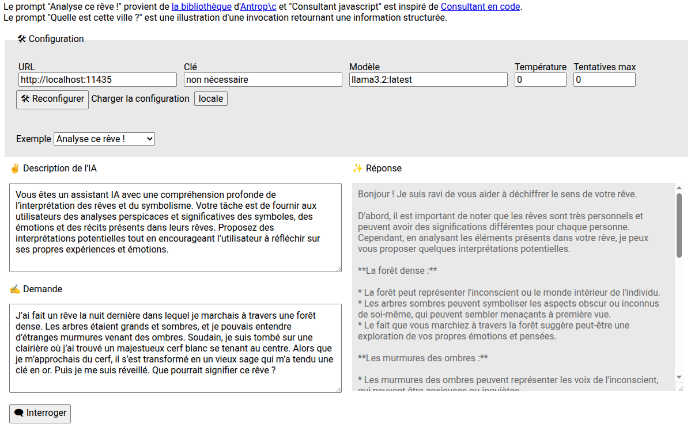
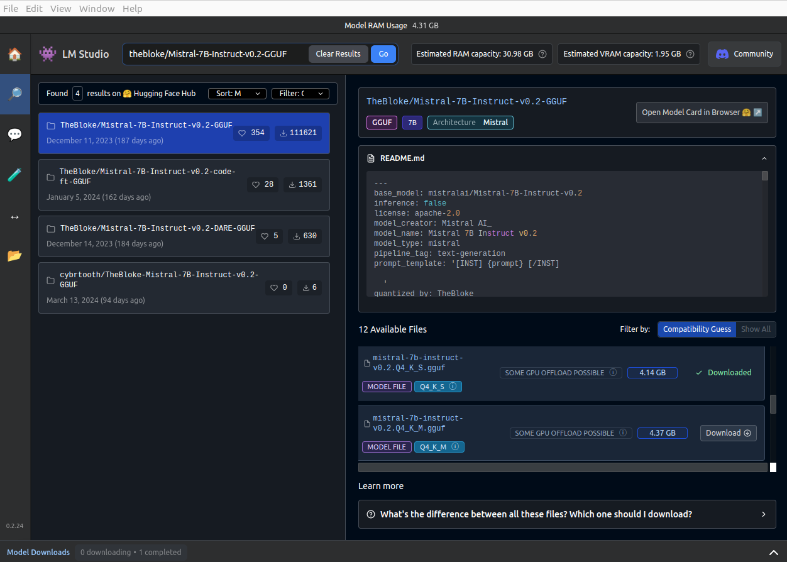
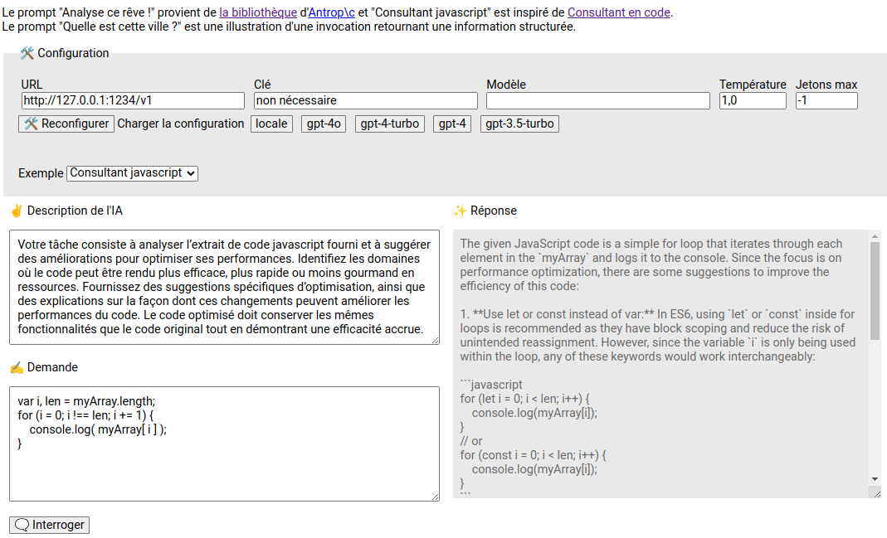

# AI walkthrough : LLM & intégration

Cette page fournit quelques informations sur la **découverte d'outils en lien avec l'intelligence artificielle**, sur le volet utilisation et intégration de **Large Language Models** (LLMs).

Un LLM est un modèle d'apprentissage profond entraîné sur un gros volume de données capable de comprendre et générer des informations en langage avancé : langage naturel, traduction de texte, résolution de problèmes, etc.

## Handball Arena

### Claude code et modèle Fable 5.2, méthode `Abyssal Garden`

Méthode d'[Abyssal Garden](https://github.com/Noniv/abyssal-garden) : un cahier des charges structuré, des contraintes dures, et des critiques indépendants qui ne voient que les rendus et les références.

Cf. [handball-arena/fable-5.2/README.md](handball-arena/fable-5.2/README.md)

* [Jouer ici !](https://raw.githack.com/cvagner/ai-llm-walkthrough/main/handball-arena/fable-5.2/index.html)

### Opencode et modèle [Ox Alpha](https://oxalpha.com/)

Cf. [handball-arena/glm-5.3-flash/README.md](handball-arena/glm-5.3-flash/README.md)

* [Jouer ici !](https://raw.githack.com/cvagner/ai-llm-walkthrough/main/handball-arena/glm-5.3-flash/index.html)

## Open WebUI et Ollama (`docker` et intégration)

Cf. [openwebui-with-ollama-in-docker/README.md](openwebui-with-ollama-in-docker/README.md)

**Interface utilisateur d'Open WebUI :**
* 

**Exemple de développement (intégration) :**
* 

## Chat local avec PostgreSQL/PostGIS (Open WebUI, Ollama et MCP)

Discuter en langage naturel avec une base PostGIS : le modèle local interroge la base par le serveur MCP [postgres-mcp](https://github.com/crystaldba/postgres-mcp), exposé à Open WebUI par [mcpo](https://github.com/open-webui/mcpo). Tout est configuré par `docker compose up -d`, sans clic.

Cf. [local-chat-with-postgres/README.md](local-chat-with-postgres/README.md)

## Langchain et LMStudio (intégration)

Cf. [langchain-with-lmstudio/README.md](langchain-with-lmstudio/README.md)

**Interface utilisateur de LMStudio :**
* 

**Exemple de développement (intégration) :**

* 
