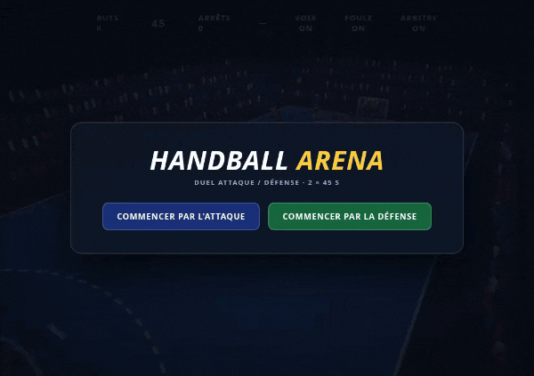

# 🤾 Handball Arena — essai du modèle **Ox Alpha**

* [Jouer ici !](https://raw.githack.com/cvagner/ai-llm-walkthrough/handball-arena/index.html)



> **Objectif de ce projet** : servir de cas de test pour le modèle **[Ox Alpha](https://oxalpha.com/)**.
> Le jeu a été conçu, codé, corrigé et enrichi de bout en bout par l'agent en quelques dizaines de minutes — architecture three.js,
> physique, IA, animations articulées, audio procédural, synthèse vocale, ralentis cinématiques…
> Chaque itération utilisateur (règles du handball, duels, passes, posture étoile du gardien,
> public, arbitre Zoro…) a été intégrée puis validée automatiquement. **Le jeu est le test ; le code, le résultat.**
>
> 🔗 En savoir plus sur le modèle : <https://oxalpha.com/>

---

## ⚙️ Développement piloté par IA : **OpenCode** + **OpenCode Zen**

Ce projet n'a pas été écrit à la main : **l'intégralité du développement a été pilotée via [OpenCode](https://opencode.ai/)**,
l'agent de développement en ligne de commande, branché sur le modèle **Ox Alpha** grâce au provider
**[OpenCode Zen](https://opencode.ai/zen)** (la passerelle de modèles curatés d'OpenCode).

- **Agent** : [OpenCode](https://opencode.ai/) — terminal, itératif, outillé (lecture/écriture de fichiers, shell…)
- **Modèle** : [`ox-alpha`](https://oxalpha.com/) — conception, code, corrections et équilibrage
- **Provider** : [OpenCode Zen](https://opencode.ai/zen) — accès au modèle directement depuis OpenCode

Le projet embarque sa configuration OpenCode (`opencode.json`), qui montre comment exposer le modèle :

```json
{
  "$schema": "https://opencode.ai/config.json",
  "provider": {
    "openrouter": {
      "npm": "@ai-sdk/openai-compatible",
      "name": "OpenRouter",
      "options": {
        "baseURL": "https://openrouter.ai",
         "timeout": 600000,
         "apiKey": "sk-or-v1-XXXX_METTRE_SA_CLE_OU_VIA_OPENCODE_DIRECTEMENT_XXXXXX"
      }
    }
  },
  "model": "openrouter/stealth/ox-alpha"
}
```

> 💡 Avec OpenCode Zen, la logique reste identique : on déclare le provider fourni par Zen
> et on pointe `"model"` vers `ox-alpha` — OpenCode gère ensuite tout le cycle
> *demande → code → test → correction* qui a produit ce jeu.

---

## 🎮 Le jeu en bref

Petit match de handball 3D **7 contre 7** (6 joueurs de champ + gardien) jouable dans le navigateur.
Deux périodes de **45 secondes** :

| Période | Rôle | But du joueur |
|---|---|---|
| 1ʳᵉ / 2ᵉ (au choix) | **Attaque** | Marquer un maximum de buts contre un mur 6-0 et un gardien IA |
| L'autre | **Défense** | Incarner le gardien et arrêter les tirs de l'attaquant IA |

Un résumé statistiques + verdict clôt le match.

## ✨ Fonctionnalités

### Attaque
- Déplacements **ZQSD / WASD / flèches**, visée à la souris.
- **Tir chargé** (clic ou Espace maintenu) : **18 tirs sur 20 partent en suspension** — saut, balle conservée
  dans la main forte, expulsion au coup de poignet.
- **Passes ciblées** (`E` / clic droit) : matrice réaliste des postes (ailier ↔ arrière, arrière → demi-centre/pivot,
  pivot → tout le monde), proximité ≤ 9 m, coéquipier choisi par le curseur (anneau bleu).
- **Duels 1 contre 1** : `Maj` = changement de direction en 3 appuis, `R` = roulette (rotation horaire
  sur un axe décentré à gauche). Le défenseur se fait piéger.
- Règles respectées : interdiction des **6 m** (saut obligatoire pour conclure), avancée bloquée si pressé à 4 m,
  ballon porté dans la main forte, passes interceptables par le mur ou le presser.

### Défense
- Vous êtes gardien : déplacement sur la ligne à la souris/flèches, **plongeon** (clic/Espace)
  avec **posture étoile** (bras écartés, jambe opposée au ballon levée).
- L'attaquant IA s'installe, tire dans les coins… et joue parfois une passe que vous pouvez couper.

### Ambiance & finitions
- **Arbitre Zoro** : tout de noir vêtu (cape, masque, chapeau cavalier, moustache, épée au flanc),
  placé au tiers du terrain derrière la ligne des arrières ; il siffle les buts, les fins de période
  et la fin du match (`ARBITRE ON/OFF`).
- **Public** : ~900 spectateurs instanciés qui ondulent et sautent lors des ovations,
  foule sonore procédurale (`FOULE ON/OFF`).
- **Commentateur vocal** français (Web Speech API) avec variantes de répliques (`VOIX ON/OFF`),
  et cri légendaire occasionnel d'un certain plombier caché dans les gradins.
- **Ralentis cinématiques** sur les beaux buts et les belles actions défensives :
  relecture exacte (toutes les articulations enregistrées) avec caméra orbitale.
- Terrain réglementaire dessiné (zones 6 m, 9 m pointillés, 7 m), gradins, bordures, éclairage + ombres.

## 🕹️ Contrôles (résumé)

| Action | Attaque | Défense |
|---|---|---|
| Se déplacer | `ZQSD` / `WASD` / flèches | Souris ou flèches (ligne) |
| Viser | Souris (réticule) | — |
| Tirer | Clic / Espace maintenu → relâcher (saut auto devant les 6 m) | — |
| Passer | `E` ou clic droit (viser le coéquipier) | — |
| Feinte 3 appuis | `Maj` | — |
| Roulette | `R` | — |
| Plonger | — | Clic / Espace |

## 🚀 Lancer le jeu

Aucune dépendance locale : three.js est chargé via CDN (connexion requise).

```bash
cd handball
npx serve .          # ou : python3 -m http.server
```

puis ouvrir l'URL affichée. Ouvrir directement `index.html` fonctionne aussi.

## 🧱 Stack technique

- **three.js** (CDN, module ES) — rendu WebGL, ombres, instancing pour la foule, shader d'ondulation.
- Physique arcade maison (gravité, rebonds, filets, poteaux).
- Web Audio API : effets synthétisés + nappe de foule procédurale.
- Web Speech API : commentateur vocal FR (+ cri anglais de Mario).
- Aucun asset externe : terrains, filets et personnages générés par code.

## 📁 Fichier

Tout tient dans **`index.html`** (~1 700 lignes commentées en français).

---

*Projet généré dans le cadre d'une évaluation du modèle [Ox Alpha](https://oxalpha.com/) — développement intégralement piloté via [OpenCode](https://opencode.ai/) avec le provider [OpenCode Zen](https://opencode.ai/zen).*
