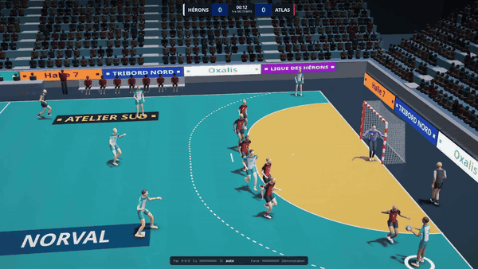

# Handball Arena — version Claude Fable 5.2

* [Jouer ici !](https://raw.githack.com/cvagner/ai-llm-walkthrough/main/handball-arena/fable-5.2/index.html)



Un match de handball à 7 en 3D dans le navigateur : un seul [`index.html`](index.html), sans moteur, sans bibliothèque 3D et sans fichier externe. Joueurs, salle, public, ballon et marques (inventées) sortent du code.

Cette version suit la méthode du dépôt [uno-com-escada](https://github.com/viktorkav/uno-com-escada), elle-même reprise d'[Abyssal Garden](https://github.com/Noniv/abyssal-garden) : un cahier des charges structuré ([`prompt.txt`](prompt.txt)), des contraintes dures, et des critiques indépendants qui ne voient que les rendus et les références.

## Jouer

Ouvrir `index.html` dans Chrome, Edge ou Firefox récents, sur ordinateur. Il faut WebGL2 ; rien à installer, pas de réseau.

- **Match** : vous dirigez les Hérons (en blanc) contre Atlas (en rouge), en attaque comme en défense.
- **Match d’exhibition** : les deux équipes jouent seules.
- **Entraînement** : rejoue une combinaison ou un geste de tir à la demande (`T` : ralenti, `C` : caméra).

Les commandes (clavier, souris, manette) sont listées à l'écran d'accueil et dans le menu de pause.

## Ce qui est simulé

- **Règles** (Livret de l'arbitrage FFHandball, octobre 2025) : trois pas, trois secondes, dribble et reprise de dribble, surface de but, jeu passif (geste d'avertissement puis quatre passes), jet franc à 9 m avec défenseurs à 3 m, jet de 7 m, engagement, remise en jeu, renvoi, avertissement, exclusion de 2 minutes, disqualification à la troisième exclusion.
- **Postes** : ailiers, arrières, demi-centre, pivot, gardien ; gauchers à droite.
- **Défenses** : 0-6, 1-5 et 3-2-1, avec flottement côté ballon, montée sur le porteur et contre.
- **Combinaisons** : l'espagnole (croisé central, quatre variantes, fiche f196), yago (quatre variantes, d'après des captures de match), croisé arrière-ailier (fiche f703).
- **Tirs** : en appui, en suspension, à la hanche, désaxé, d'ailier, en plongeant, lob, chabala, roucoulette, kung-fu, jet de 7 m.
- **Gardien** : placement sur l'angle, temps de réaction, erreur de lecture, parade de la main ou du pied ; l'arrêt est décidé par la collision réelle du ballon avec le corps.

## État à la fin de la troisième tranche (22 novembre 2026)

Trois tranches de travail, douze tours de critiques. **Le critère de fin n'est pas atteint** : les trois critiques signalent encore des défauts graves.

| Vérification | Résultat |
|---|---|
| Règles et commandes (`travail/outils/regles.mjs`) | 28 tests réussis sur 28 — [`travail/rapport-regles.md`](travail/rapport-regles.md) |
| Match automatique complet (`travail/outils/fumee.mjs`) | 2 × 5 min joués jusqu'au bout sans blocage ni erreur (21-15, 302 passes reçues sur 326) |
| Performance (`travail/outils/perf.mjs`), 1920×1080, Radeon 780M | 8,2 ms par image en moyenne, 99e centile 30 ms, 218 images sur 3 600 au-dessus de 16,7 ms : **critère non tenu** |
| Critique visuel, défauts graves par tour | 10, 5, 6, 7, 5, 4, 5, —, 6, 7 — **non passé** |
| Critique handball, défauts graves par tour | 8, 7, 2, 4, 1, 2, 2, 2, 1, 4, 3 — **non passé** |
| Critique de la démarche (à partir du tour 9) | 6, 4, 6, 5, 4, 3 — **non passé** |

Chaque critique est un sous-agent neuf qui ne voit que les rendus et les références, et qui rend au plus 12 à 15 défauts : le décompte mesure les pires défauts restants, pas un total. Les avis résumés sont dans `travail/critique/tour1` à `tour12` (`avis.md`) ; les rendus jugés ne sont pas versionnés. Les dernières corrections de chaque domaine n'ont pas été rejugées. La performance est un temps mur par image (simulation, rendu et `gl.finish()`) mesuré dans Chrome sans fenêtre, parfois pendant que d'autres tâches tournaient ; les requêtes de temps GPU ne sont pas utilisées. Le GIF en tête de page reprend 5 s (de 13 à 18 s) de la séquence de 60 s de l'état final ; la vidéo n'est pas versionnée. Les images et documents de `reference/` ne sont pas versionnés.

Fait pendant la troisième tranche :

- **Démarche**, d'après `reference/repli-ex1` et `repli-ex2` : jambe d'appui presque tendue et bassin au plus haut au croisement, pieds posés sur une ligne étroite, phase de suspension en course, talon qui remonte, coudes à angle droit, déroulé du pied, foulée irrégulière et propre à chaque joueur, pas chassés fléchis à base large, recul en garde face au porteur, repli couru face à la course quand il n'y a pas de danger.
- **Corrections demandées** : dribble ralenti, ballon prisonnier du filet, arbitres qui ne courent plus sur place, visages moins sphériques, bras qui ne traversent plus le tronc, lob de loin qui ne passe que si le gardien est très avancé.
- **Handball** : chabala (gardien sorti bras hauts qui se livre sur la feinte, cloche courte), roucoulette, plongeon allongé avec réception à plat ventre, écran qui retient un instant le défenseur, minutage de l'espagnole (le demi-centre attend la course de l'ailier), tireur arrêté par le contreur au lieu de le traverser.
- **Défaut trouvé hors critiques** : les longues passes de contre-attaque sortaient derrière le but (jusqu'à 100 renvois par match) ; l'avance de la passe est bornée à la course du receveur.
- **Outils** : `travail/outils/demarche.mjs` produit les rafales rapprochées de déplacement.

Ce qui manque encore par rapport au cahier des charges : personnages et public au niveau des références (modelé, textures, tissu) ; résolution fine des contacts entre joueurs ; transitions d'allure et demi-tours décomposés ; flou de mouvement et anticrénelage temporel ; ralenti rejoué après un but ; temps morts, changements par la zone de changement, gardien sorti pour jouer à 7 ; règle de l'avantage ; son et habillage (second prompt). L'absence d'allocation par image n'a pas été vérifiée, et le jeu n'a été essayé que par ses tests automatiques et ses rendus, pas manette en main.

## Quatrième tranche et reprise (22 novembre 2026)

**Le critère de fin n'est toujours pas atteint.** État final mesuré :

| Vérification | Résultat |
|---|---|
| Règles et commandes | 30 tests réussis sur 30 |
| Match automatique complet, 2 × 5 min | joué jusqu'au bout sans erreur (13-13, 343 passes reçues sur 372) |
| Performance, 1920×1080, Radeon 780M | 7,5 ms par image en moyenne, 99e centile 23 ms, 91 images sur 3 600 au-dessus de 16,7 ms : **critère non tenu** |
| Allocations par image | croissance du tas mesurée à 0 octet par image sur 1 800 images |
| Critique handball, défauts graves (tours 13 à 15) | 2, 1, 1 — **non passé** |
| Critique de la démarche (tours 13 à 16) | 2, 5, 5, 4 — **non passé** |
| Critique visuel (tours 14 et 15) | 6, 5 — **non passé** |

Les dernières corrections de chaque domaine n'ont pas été rejugées. Les tableaux de la section précédente datent de la fin de la troisième tranche. La séquence finale et `travail/critique/tour16/avis.md` correspondent à l'état final.

Ajouté depuis la troisième tranche :

- **Dribble** : l'avant-bras pivote au coude de +5° à -42° sur l'horizontale, coude plié au flanc, main à la taille ; le ballon rebondit devant le joueur, du côté de sa main (mesures dans `travail/critique/tour16/avis.md`).
- **Jeu** : ralenti rejoué après un but (Espace pour passer), règle de l'avantage, temps mort d'équipe (touche B, deux par mi-temps), attaque placée plus patiente, temps de réaction de la défense après une combinaison, gardien avancé sur les jets de 7 m.
- **Yago** : quatre variantes, dont la principale suit la lecture capture par capture du tour 15 (passe à l'arrière droit, entrée du demi-centre en second pivot à droite, pivot ressorti en arrière gauche, renversement jusqu'à l'ailier gauche). **Cette lecture reste à confirmer par quelqu'un qui connaît la combinaison.**
- **Démarche** : jambe d'appui fléchie en course, bras calés sur les épaules et en opposition, poings mi-clos, changements de posture fondus.
- **Image** : doigts refermés sur le ballon avec pouce opposé, public à épaules et bras, remplaçants assis avec jambes, caméra de retransmission resserrée, qualité graphique adaptative.

Ce qui manque encore : personnages et public au niveau des références ; résolution fine des contacts entre joueurs ; roucoulette (encore jugée fausse au tour 15) ; écrans qui libèrent vraiment le tireur ; changements par la zone de changement, gardien sorti pour jouer à 7 ; flou de mouvement et anticrénelage temporel ; son et habillage (second prompt). Le jeu n'a été essayé que par ses tests automatiques et ses rendus.

## Retours de jeu intégrés ensuite (22 novembre 2026)

32 tests réussis sur 32. Non rejugé par les critiques.

- **Gabarits par poste** : ailiers de 1,70 à 1,85 m, plus légers, plus rapides et plus vifs à l'accélération ; arrières et demi-centres de 1,85 à 1,95 m ; pivots de 1,88 à 1,95 m, nettement plus lourds et moins vifs.
- **Temps faible et temps fort** en attaque placée : en temps faible, le ballon circule posément de voisin à voisin ; après trois à cinq passes, un arrière déclenche le temps fort en attaquant en accélération l'intervalle libre suivant. S'il est libre il tire, sinon il fixe et décale le voisin, qui arrive lancé et attaque l'intervalle suivant ; au bout, l'ailier tire ou le ballon revient. Planche : `node travail/outils/temps-fort.mjs`.
- **Pas de longue passe en jeu placé** : hors combinaison, le jeu automatique ne passe jamais par-dessus un voisin (0 sur 278 passes dans le match de test). Restent permises les passes au pivot, les relances de montée de balle quand la passe est dégagée, et la passe à l'opposé du croisé arrière-ailier, qui vient de la fiche f703.
- **Écartés à la demande** : jeu à 7 sans gardien et changements par la zone de changement. La roucoulette est jugée bonne par l'utilisateur.

## Cinquième tranche (22 novembre 2026)

**Le critère de fin n'est toujours pas atteint.** Le GIF en tête de page montre l'état final, qui n'a pas été jugé.

| Vérification | Résultat |
|---|---|
| Règles et commandes | 32 tests réussis sur 32 |
| Match automatique complet, 2 × 5 min | joué jusqu'au bout sans erreur (11-11, 351 passes reçues sur 382, 43 temps forts) |
| Performance, 1920×1080, Radeon 780M | 7,5 ms par image en moyenne, 99e centile 22,6 ms, 95 images sur 3 600 au-dessus de 16,7 ms : **critère non tenu** |
| Critique handball, tour 17 | 2 graves, 8 moyens, 4 mineurs — **non passé** |
| Critique de la démarche, tour 17 | 3 graves, 8 moyens, 1 mineur — **non passé** |

- **Menus et affichage aux tons Bleu/vert** : turquoise `#00b2a9` et `#80d8d4`, bleus `#1f3a93` et `#042368`, fond `#0f1826`.
- **Contacts** : séparation plus ferme entre adversaires, buste redressé au contact, avant-bras repoussés hors du tronc adverse.
- **Écrans** : le tireur final d'une combinaison vise l'intervalle ouvert le plus proche et tire en suspension avant le contact. L'espagnole (variantes 1 à 3) et le croisé arrière-ailier se terminent par un tir dans les traces de `travail/outils/trace-combo.mjs`.
- **Pas chassés** : le buste et les bras accompagnent les appuis.
- **Non modifiés, à la demande** : yago ; équilibre entre gardien, défense et temps fort.

Les corrections faites après le tour 17 ne sont pas rejugées (`travail/critique/tour17/avis.md`). Restent signalés : pieds qui glissent en pas chassés, pose figée après une interception, fixations qui n'attirent pas le défenseur voisin, et les défauts visuels de fond (personnages, public, éclairage). La manette n'a pas été réessayée depuis l'ajout des temps forts.

## Son (22 novembre 2026)

Tout le son est synthétisé dans le navigateur (Web Audio), sans fichier : `source/js/65_audio.js`. Touche `M` pour le couper.

- **Public** : murmure permanent, clameur qui monte sur les tirs, les arrêts et les buts (plus forte pour les Hérons, à domicile), applaudissements après un but.
- **Arbitres** : sifflet à bille sur chaque coup de sifflet du jeu, deux coups brefs sur un but, sirène de la table à la mi-temps et à la fin.
- **Chaussures** : crissement une à trois fois sur quinze au déclenchement d'une accélération ou d'un freinage à fond.
- **Demi-centre** : annonce de la combinaison (« Espagnole ! », « Yago ! », « Croisé ! ») par la voix française du navigateur s'il en a une, sinon par un cri en voyelles synthétisées.
- **Ballon** : rebonds du dribble, réception dans les mains, poteau, filet.

Vérifié par `travail/outils/son.mjs` (aucune erreur, signal émis, décompte des sons) ; **le rendu n'a pas été écouté**, les timbres et les niveaux sont à régler à l'oreille. Le son ne touche pas à la simulation : les 32 tests passent toujours.

## Modifier le code

Les sources lisibles sont dans [`source/`](source). Pour réassembler `index.html` (Node.js 18 ou plus, aucun paquet) :

```bash
node source/build.mjs
```

| Fichier | Contenu |
|---|---|
| `js/10_court.js` | Cotes du terrain, postes, systèmes défensifs |
| `js/45_combos.js` | Les combinaisons, décrites en données. **Un bon endroit pour commencer.** |
| `js/40_player.js` | Squelette, démarche et animation procédurale, gestes de tir |
| `js/21_body.js` | Corps des joueurs : surfaces continues, mains, visage |
| `js/50_sim.js` | Ballon, règles, arrêts et reprises du jeu |
| `js/51_ai.js` | Attaque, défense, gardien, joueur dirigé, entraînement |
| `js/20_render.js`, `js/30_arena.js`, `js/01_gl.js` | Rendu WebGL2, salle, maillages |
| `js/65_audio.js` | Son synthétisé : public, sifflets, crissements, annonces |
| `js/60_input.js`, `js/70_game.js`, `js/90_main.js` | Entrées, caméras, menus, boucle principale |

Les outils de vérification (`travail/outils/`) demandent `playwright-core` et Chrome :

```bash
cd travail/outils && npm install
```
